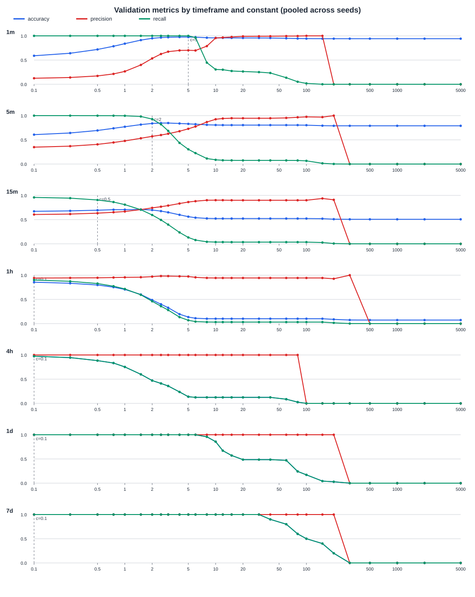
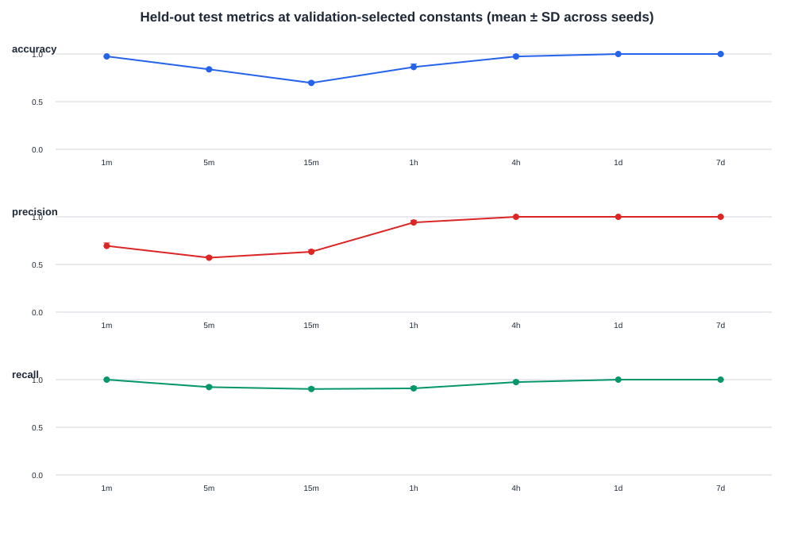

# Scenario 2: optimal constant by sliding-window timeframe

## Summary

This experiment independently sweeps the tested standard-deviation constants `c` for each requested rolling timeframe. The candidate grid is `[0.1, 0.25, 0.5, 0.75, 1, 1.5, 2, 2.5, 3, 4, 5, 6, 8, 10, 12, 15, 20, 30, 40, 60, 80, 100, 150, 200, 300, 500, 1000, 2000, 5000]`; the selected value is the best candidate in that grid, not a continuous optimization. Constants are selected using pooled validation F1; the held-out test period is not used to select them. These results are for the checked-in **synthetic generator and row-count sliding-window implementation**, not production traffic.

## Protocol

- Signal: sum of `rows_returned` for the same database and database user over the trailing window `(timestamp - duration, timestamp]`, using `common.SlidingRowWindow`.
- Timeframes: 1m, 5m, 15m, 1h, 4h, 1d, 7d.
- Threshold: predict anomalous when the current rolling total is strictly greater than `training_mean + c * training_stddev`. Mean and population standard deviation are calculated from warmed-up read-event window totals in the training period.
- Ground truth: the current read event's generator-provided `is_ground_truth_anomalous` label. Each incoming read is one scored sample; windows overlap because they advance on each read.
- Constant selection: maximize pooled validation F1 (harmonic mean of precision and recall); ties prefer higher precision, then higher accuracy, with the lower `c` retained for any remaining tie. Accuracy, precision, and recall are reported alongside F1.
- Simulation: 28 UTC days of training, 7 validation days, and 7 held-out test days; legacy generator buckets are 60 minutes. Start time is 2026-01-05 00:00 UTC. Ten fixed seeds (42–51) use `v1/client/query_template_config_s2.textproto`.
- Baseline warm-up: discard training window totals until one complete timeframe has elapsed from the start. At evaluation start, the rolling window retains recent training events.
- Test summary: arithmetic mean and population standard deviation of each metric across the ten per-seed test runs. Pooled test confusion counts are also included in the CSV.

## Results

| Timeframe | Selected `c` | Validation F1 | Validation accuracy | Validation precision | Validation recall | Test accuracy (mean ± SD) | Test precision (mean ± SD) | Test recall (mean ± SD) | Test F1 (mean ± SD) |
|---:|---:|---:|---:|---:|---:|---:|---:|---:|---:|
| 1m | 15.00 | 0.823 | 0.981 | 0.974 | 0.713 | 0.981 ± 0.001 | 0.938 ± 0.113 | 0.648 ± 0.226 | 0.746 ± 0.241 |
| 5m | 15.00 | 0.811 | 0.980 | 0.976 | 0.694 | 0.980 ± 0.001 | 0.880 ± 0.293 | 0.632 ± 0.231 | 0.731 ± 0.254 |
| 15m | 10.00 | 0.791 | 0.977 | 0.922 | 0.693 | 0.977 ± 0.001 | 0.842 ± 0.251 | 0.630 ± 0.230 | 0.714 ± 0.247 |
| 1h | 8.00 | 0.711 | 0.965 | 0.741 | 0.683 | 0.966 ± 0.006 | 0.683 ± 0.228 | 0.622 ± 0.227 | 0.647 ± 0.223 |
| 4h | 6.00 | 0.516 | 0.920 | 0.418 | 0.674 | 0.927 ± 0.025 | 0.404 ± 0.135 | 0.616 ± 0.226 | 0.485 ± 0.166 |
| 1d | 15.00 | 0.228 | 0.687 | 0.135 | 0.730 | 0.689 ± 0.113 | 0.128 ± 0.042 | 0.686 ± 0.231 | 0.215 ± 0.070 |
| 7d | 15.00 | 0.136 | 0.318 | 0.074 | 0.850 | 0.063 ± 0.020 | 0.063 ± 0.020 | 1.000 ± 0.000 | 0.118 ± 0.036 |

Validation metrics by candidate constant (all seven timeframes):

Held-out test metrics at the validation-selected constant:

Full validation sweep is in [`constant_sweep.csv`](constant_sweep.csv). Test metric columns are populated only for the validation-selected constant of each timeframe, to keep the held-out set out of constant selection.

## Interpretation and limitations

This branch's implemented `SlidingRowWindow` sums `rows_returned`, so this experiment tests **rolling returned-row volume**, not query count. Ground truth is the label of the current read event, and one read event is one evaluation sample; it does not aggregate event labels into fixed or overlapping time-bucket labels. The current generator emits synthetic, deliberately injected anomalies; selected constants are specific to this configuration, event-label semantics, split, candidate grid, and seed set. Results should not be interpreted as a production threshold or compared numerically with the intern's results until their data, split, label aggregation, and optimization objective are aligned. The next phase can combine timeframe signals after these single-frame constants are reviewed.
